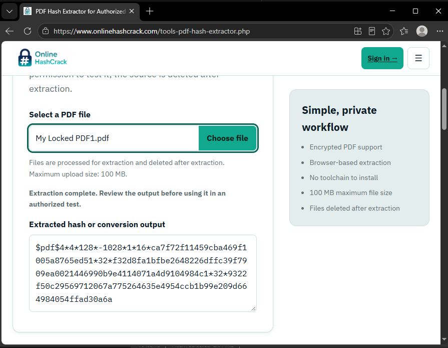
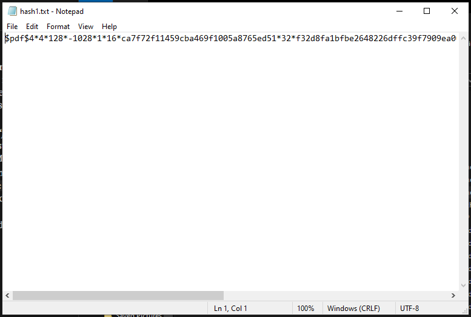
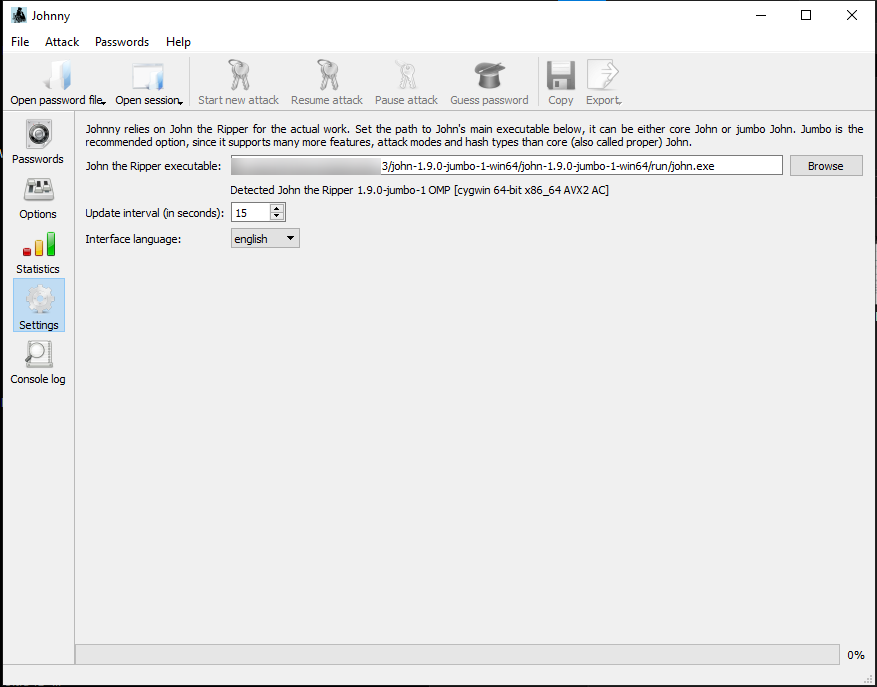
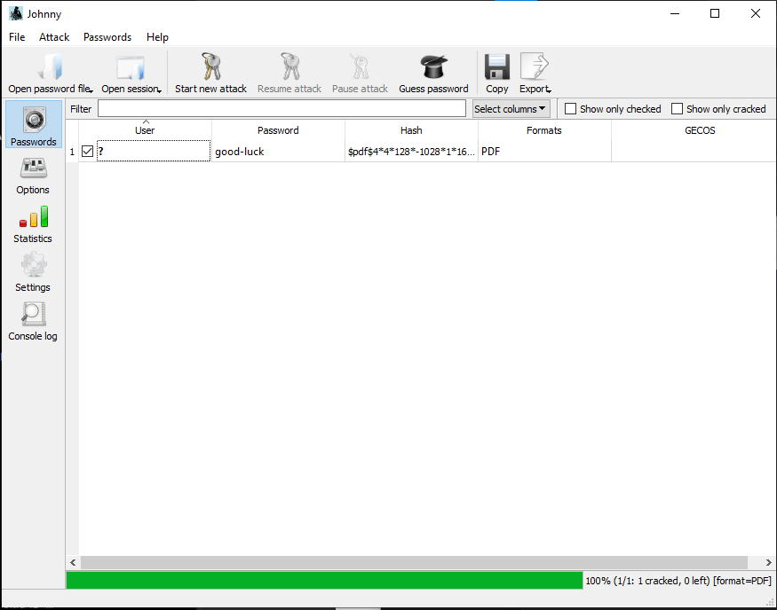
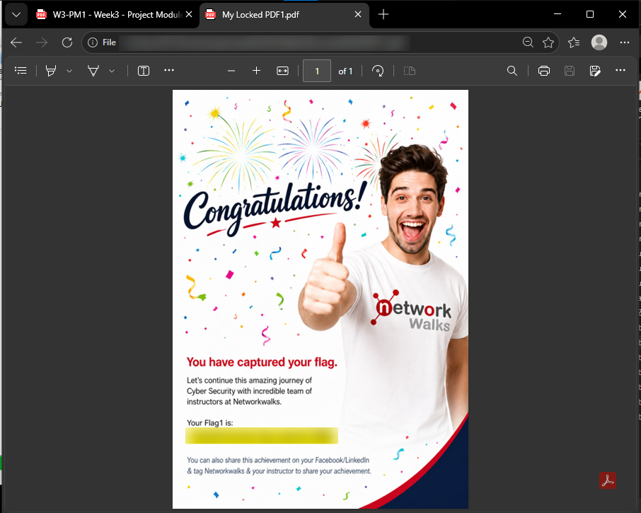
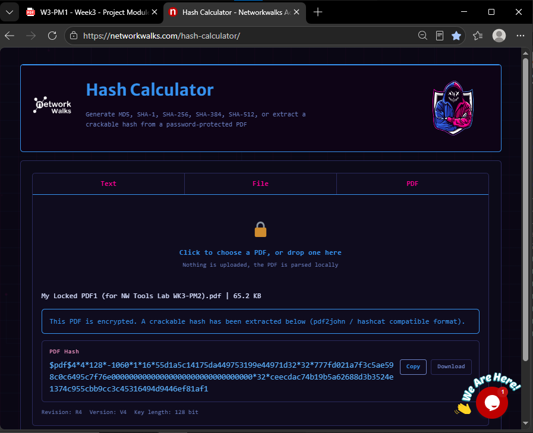
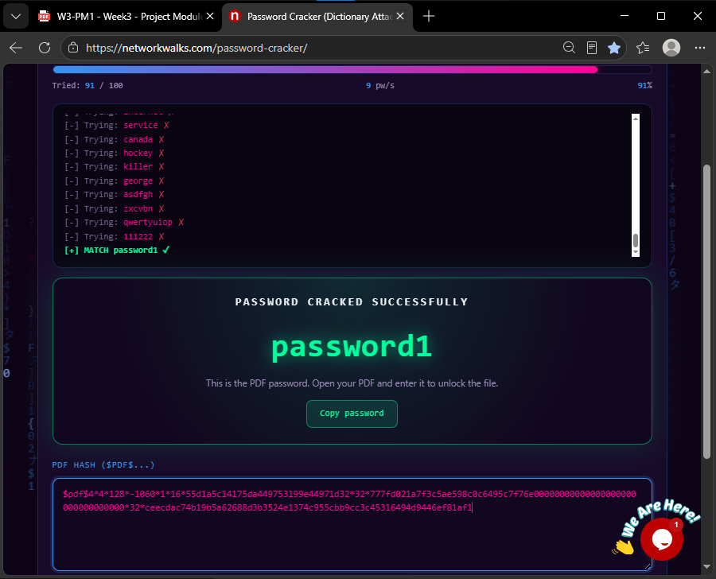
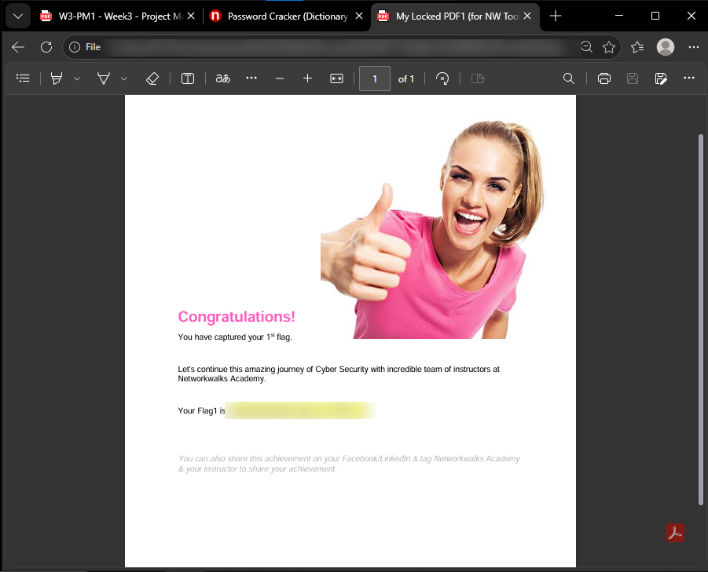

# Week 3 Practical: Password Cracking with JTR and Networkwalks Tools

**Program:** Networkwalks Cybersecurity Internship, Batch B082
**Author:** Zayyad Abdullahi
**Modules:** W3-PM1 (Password Cracking with JTR), W3-PM2 (Password Cracking with NW Tools)

## Overview

This repository contains my Week 3 practical report. It covers recovering the passwords of two password-protected PDF files, one with John the Ripper (JTR) and Johnny, and one with the Networkwalks Hash Calculator and Password Cracker. For each module, the report shows how the hash was extracted from the PDF, how the password was recovered, and how the recovered password opened the file.

## Scope and Authorization

Both PDF files were provided by the course instructor as lab exercises. All password cracking was performed offline against those two files. No live systems, networks, or third-party accounts were accessed.

## Tools Used

| Tool | Purpose |
|---|---|
| John the Ripper 1.9.0-jumbo-1 (via Johnny) | Password cracking engine for the PDF hash (W3-PM1) |
| Johnny | Graphical front end for John the Ripper (W3-PM1) |
| OnlineHashCrack PDF Hash Extractor | Extract the `$pdf$` hash from the locked PDF (W3-PM1) |
| Networkwalks Hash Calculator | Extract the `$pdf$` hash locally in the browser (W3-PM2) |
| Networkwalks Password Cracker | Dictionary attack against the extracted hash (W3-PM2) |
| Web browser / PDF reader | Open the locked PDFs with the recovered passwords |

## Activities Performed

### 4.1 W3-PM1: Password Cracking with JTR and Johnny

**Hash extraction.** I uploaded the locked file *My Locked PDF1.pdf* to the OnlineHashCrack PDF Hash Extractor. The tool returned a hash beginning with `$pdf$4*4*128*-1028*1*16`, which identifies PDF encryption version 4, revision 4, with a 128-bit key (Figure 1).

*Figure 1: OnlineHashCrack hash extraction*

**Preparing the hash file.** I copied the hash into Notepad and saved it as `hash1.txt`. The hash begins with `$pdf$`, with no extra characters at the start (Figure 3).

*Figure 3: Hash saved as hash1.txt*

**Configuring Johnny.** I opened Johnny, went to Settings, and selected `john.exe` from the John the Ripper run folder. Johnny detected the executable as John the Ripper 1.9.0-jumbo-1 (Figure 2).

*Figure 2: Johnny settings with john.exe detected*

**Cracking.** I opened `hash1.txt` with *Open password file*, started a new attack, and Johnny recovered the password **good-luck** (Figure 4).

*Figure 4: Johnny cracked password*

**Verification.** I opened the locked PDF with the recovered password. The file opened and displayed a completion page with a flag value (Figure 5). The flag value is omitted from this report.

*Figure 5: Opened JTR-protected PDF*

### 4.2 W3-PM2: Password Cracking with Networkwalks Tools

**Hash extraction.** I opened the Networkwalks Hash Calculator, selected the PDF tab, and uploaded *My Locked PDF1 (for NW Tools Lab WK3-PM2).pdf*. The tool reported that the file was encrypted and returned a hash beginning with `$pdf$4*4*128*-1060*1*16`, with Revision R4, Version V4, and a 128-bit key length (Figure 6). The Hash Calculator states that the PDF is parsed locally and nothing is uploaded

*Figure 6: Networkwalks Hash Calculator output*

**Cracking.** I pasted the hash into the Networkwalks Password Cracker and started the dictionary attack using its built-in list of 100 passwords. The tool matched **password1** after trying 91 of the 100 words (Figure 7).

*Figure 7: Networkwalks Password Cracker match*

**Verification.** I opened the locked PDF with the recovered password. The file opened and displayed a completion page with a flag value (Figure 8). The flag value is omitted from this report.

*Figure 8: Opened NW-tools-protected PDF*

## Results

| File | Hash version | Tool | Password recovered | Opened? |
|---|---|---|---|---|
| My Locked PDF1.pdf (W3-PM1) | V4, R4, 128-bit (P = -1028) | Johnny / John the Ripper | good-luck | Yes |
| My Locked PDF1 (for NW Tools Lab WK3-PM2).pdf (W3-PM2) | V4, R4, 128-bit (P = -1060) | Networkwalks Password Cracker | password1 | Yes |

The two files have different hash parameters and different passwords, so each recovered password applies only to its own file.

## Risk Analysis / Impact

| # | Risk / Finding | Evidence / Observation | Potential Impact | Risk Level |
|---|---|---|---|---|
| 1 | Weak passwords | good-luck was recovered by John the Ripper, and password1 was recovered from a 100-word built-in list | Anyone with a copy of the file can recover the password quickly | High |
| 2 | Encrypted PDF hash can be extracted from the file | Both hashes were extracted from the PDF files without knowing the password | Protection depends entirely on password strength, because attackers can crack the hash offline | Medium |
| 3 | Sensitive file uploaded to a third-party site | The OnlineHashCrack extractor requires uploading the PDF to an external website | Document contents or the hash could be exposed to a third party | Medium |
| 4 | Small dictionary is sufficient | password1 was found within the first 91 words of the built-in list | Common passwords fall to basic dictionary attacks in seconds | High |

The risks above are based on this lab. The two PDF files were chosen by the instructor to be cracked, so the results show how quickly weak passwords fail, not how any real system would perform.

## Recommendations

1. **Use long passphrases.** Length matters more than complexity. A passphrase of four or more unrelated words is much harder to crack than a short password with symbols.
2. **Avoid common and dictionary passwords.** Do not use words like "password," "password1," or "good-luck," or simple patterns like names and dates.
3. **Use a password manager.** A password manager can generate and store strong, unique passwords for each file and account.
4. **Use strong PDF encryption.** Choose AES-256 encryption when protecting PDF files, and set a strong user password.
5. **Extract hashes locally for sensitive files.** Use tools that run in the browser or on your own machine, such as the Networkwalks Hash Calculator, so the file is not uploaded to an external site.
6. **Test your own passwords.** Use a tool like JTR in a lab to check whether your passwords would survive a dictionary attack before relying on them.

## Conclusion

During Week 3 of my Cybersecurity & Ethical Hacking internship, I recovered the passwords of two password-protected PDF files using two different approaches.

In W3-PM1, I extracted the hash using an online extractor and cracked it with Johnny, which runs the John the Ripper engine. The password was good-luck.

In W3-PM2, I extracted the hash locally with the Networkwalks Hash Calculator and cracked it with the Networkwalks Password Cracker's dictionary attack. The password was password1.

Both exercises showed how little protection a weak password provides once a file's hash is available. A password does not need to be cracked by brute force to be recovered; a common word or a short built-in list is often enough. I also learned that the tools used to extract hashes can expose sensitive files if they upload them to a third party, so the method used matters.

## Evidence

- Figure 1: OnlineHashCrack hash extraction (fig1-hash-extraction.png)
- Figure 2: Johnny settings with john.exe detected (fig2-johnny-settings.png)
- Figure 3: Hash saved as hash1.txt in Notepad (fig3-hash-file.png)
- Figure 4: Johnny cracked password (fig4-johnny-cracked.png)
- Figure 5: Opened JTR-protected PDF (fig5-opened-pdf-jtr.png)
- Figure 6: Networkwalks Hash Calculator output (fig6-hash-calculator.png)
- Figure 7: Networkwalks Password Cracker match (fig7-password-cracker.png)
- Figure 8: Opened NW-tools-protected PDF (fig8-opened-pdf-nw.png)

## Disclaimer

These materials are for educational purposes only. Do not use anything here against systems, files, or accounts you do not own or have written permission to test.
